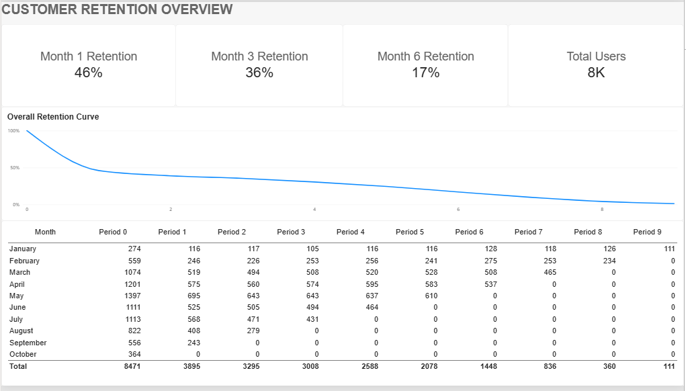
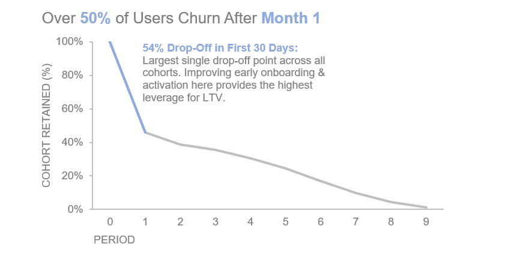
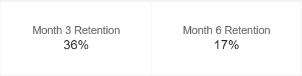
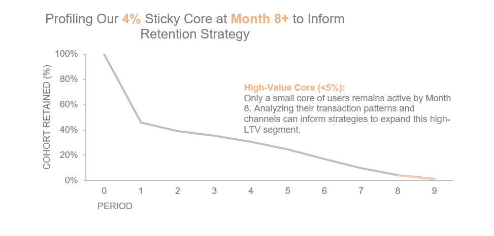

# Customer Retention Curve Analysis

**Nigerian Fintech | Wallet & Mobile Money User Retention**

---

## Project Background

This project was developed while working as a Data Analyst at a mid-sized Nigerian fintech company operating in the mobile money and digital wallet space. The company has been active for several years and provides services including cash-in/cash-out, transfers, bill payments, and merchant payments through a combination of mobile app, USSD, and agent channels.

The business model depends heavily on acquiring new users and converting them into repeat, active customers. High customer acquisition costs combined with early churn create pressure on unit economics. Key metrics tracked by the business include monthly active users, transaction volume per user, customer lifetime value (LTV), and retention rates at 1, 3, and 6 months.

As a data analyst supporting the Growth and Product teams, I built a cohort-based retention analysis to measure how long users remain active after their first successful transaction. The goal was to give the business a clear view of where users drop off and which cohorts perform better over time.

Insights and recommendations are provided on the following key areas:

- **Early Drop-off (Month 0 → Month 1)**
- **Medium-Term Retention (Month 3 & Month 6)**
- **Long-Term Sticky Users**

The SQL queries used to prepare the data and calculate the retention curve can be found here: [SQL Queries](/basic_retention.sql)

An interactive Power BI dashboard used to explore retention trends can be found here: [Power BI Dashboard](/Customer%20Retention%20Dashboard.pbix)

The stakeholder presentation slides for this project can be found here: [Presentation](/Customer_Retention_Curve_Presentation.pptx)

---

## Data Structure & Initial Checks

The analysis is based on a single cleaned transactions table containing wallet activity for approximately 8,500 users.

**Table: `wallet_transactions`**
- `transaction_id` – Unique identifier for each transaction
- `user_id` – Unique customer identifier
- `transaction_date` – Date of the transaction
- `amount` – Transaction value in Naira
- `status` – success / failed / pending
- `channel` – App, USSD, POS, Agent App, or Web
- `state` – Nigerian state where the transaction occurred

**Key checks performed:**
- Filtered to successful transactions only for retention measurement
- Confirmed date range coverage (January 2025 – October 2025)
- Verified that every user has at least one transaction (used to define cohort start)
- Checked for reasonable distribution of users across months and channels

---

## Executive Summary

### Overview of Findings

From a Growth and Product perspective, three insights stand out. First, more than half of new users do not return after their first month (Month 1 retention sits at 46%). Second, retention continues to decline steadily, reaching only 17% by Month 6. Third, the pattern of early drop-off is consistent across almost all acquisition cohorts, indicating a structural onboarding or activation problem rather than an isolated cohort issue.

---

## Insights Deep Dive

### Category 1: Early Drop-off (Month 0 → Month 1)

- Month 1 retention is 46.0%. This means over half of users who make a first transaction do not return in the following month.
- This is the single largest drop-off point in the entire retention curve and represents the highest-leverage area for improvement.
- The sharp decline appears consistently across different acquisition months, suggesting the issue is not limited to a particular marketing campaign or period.
- Improving activation and early engagement in the first 30 days would have the largest impact on overall retention and LTV.

### Category 2: Medium-Term Retention (Month 3 & Month 6)

- By Month 3, retention stands at 35.5%. Users who survive the first month show a slower rate of decline.
- By Month 6, only 17.1% of the original cohort remains active.
- The gradual decline after Month 1 indicates that while early churn is severe, a meaningful portion of users who stay past the first month continue transacting for several more months.
- These medium-term numbers provide a realistic baseline for forecasting active user growth and revenue.

### Category 3: Long-Term Sticky Users

- Only a small core of users remain active by Month 8–9 (under 5%).
- This sticky segment represents high-value customers with significantly higher lifetime potential.
- Understanding the behaviour, channels, and transaction patterns of these long-term users can inform product and retention strategies.
- Protecting and expanding this core should be a secondary but important focus alongside fixing early churn.

---

## Recommendations

Based on the insights above, we recommend the Growth and Product teams consider the following:

- The largest opportunity sits in the first 30 days. Prioritise onboarding improvements, activation campaigns, and first-week engagement experiments.
- Design product features or incentives that encourage a second and third transaction within the first two weeks of signup.
- Treat users who return in Month 1 as a higher-potential segment and invest more targeted retention efforts in them.
- Continue tracking cohort retention monthly so the impact of product and growth experiments can be measured against this baseline.
- Conduct qualitative or behavioural analysis on the small group of users still active at Month 6+ to understand what makes them stick.

---

## Assumptions and Caveats

Throughout the analysis, several assumptions and limitations should be noted:

- Retention is defined as making at least one successful transaction in a given month. Users who only hold a balance or log in without transacting are not counted as retained.
- Only successful transactions were used to determine activity. Failed or pending transactions were excluded.
- Users needed a minimum of one successful transaction to enter a cohort. Users with only failed transactions were excluded.
- Later cohorts (especially September and October) have fewer observation periods, so their long-term retention rates are not yet fully comparable to earlier cohorts.
- The analysis covers January to October 2025. Results should be re-evaluated as more months of data become available.
- Channel and state information is available for segmentation but was not the primary focus of this initial retention curve.